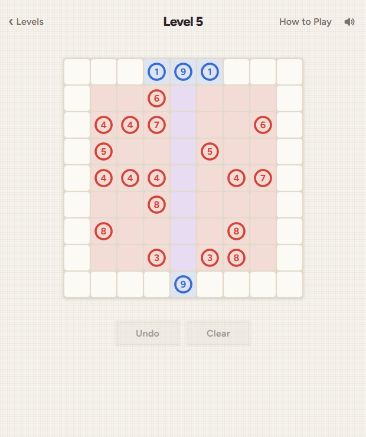
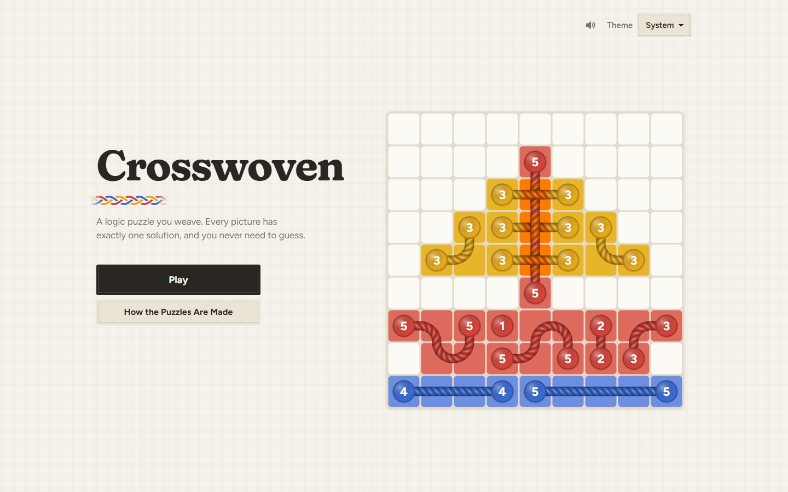
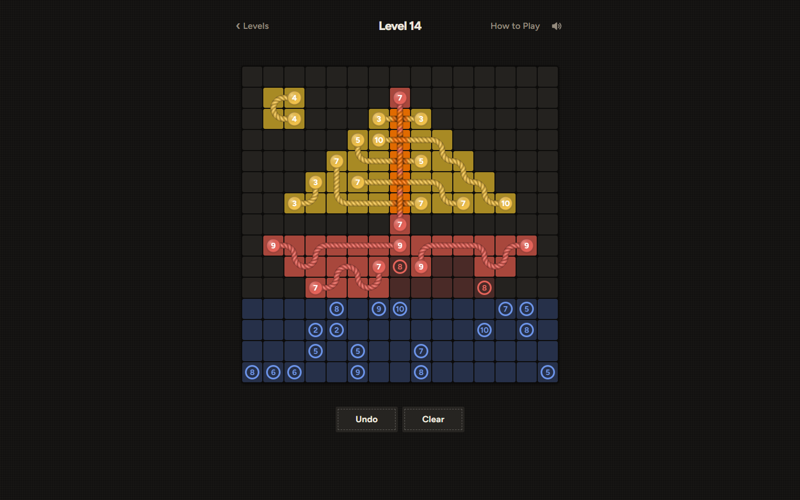
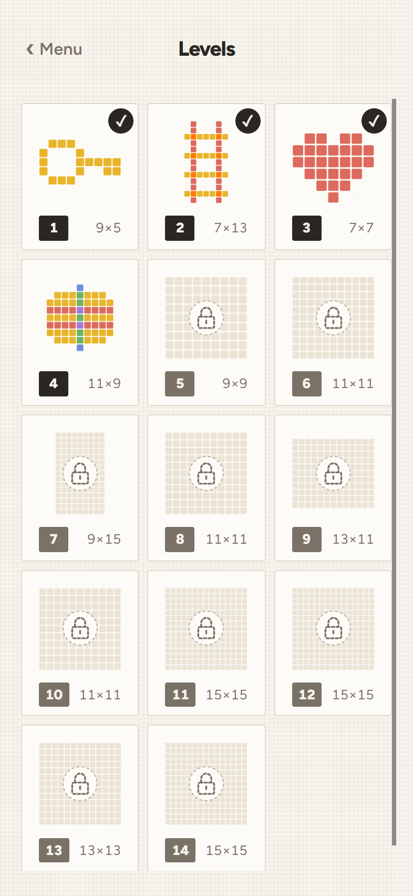
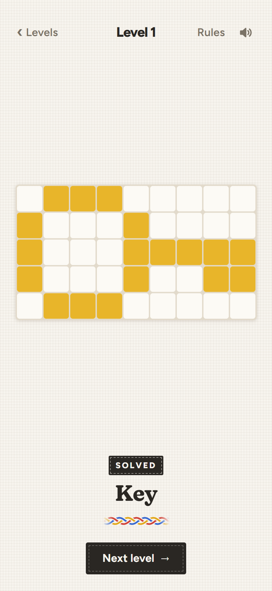
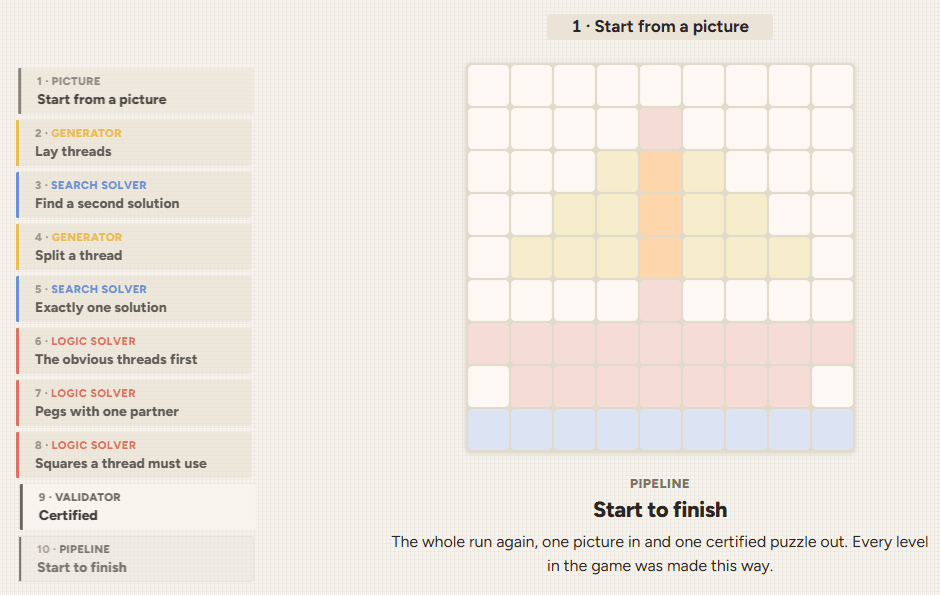

# Crosswoven

A logic puzzle for the browser. Connect numbered pegs with coloured threads to weave a pixel-art picture. Where two threads cross, their colours mix.

<p align="center">
  <picture>
    <source media="(prefers-color-scheme: dark)" srcset="docs/media/play-dark.gif">
    
  </picture>
</p>

It's based on Link-a-Pix (also called Paint by Pairs), where you join matching numbers with a path that many squares long. Colour mixing is the twist.

Every level is generated from a picture and checked by a validator: exactly one solution, and you never have to guess.

<p align="center">
  
  
</p>
<p align="center">
  
  
</p>

## How it works

The game walks through how a level is made:

<p align="center">
  <picture>
    <source media="(prefers-color-scheme: dark)" srcset="docs/media/pipeline-dark.gif">
    
  </picture>
</p>

- Each picture is a small text grid. A generator covers it with threads and puts numbered pegs at the ends
- A search solver checks there's only one solution. If it finds a second, the generator splits a thread where the two differ and tries again
- A logic solver plays it like a person, one deduction at a time, to prove it never needs a guess
- Property tests run both solvers on thousands of random puzzles and check they agree
- CI regenerates every level, so a solver change can't quietly break one
- Game state is one object, changed only by a pure `update` function, so undo is just a list of past boards and the rules are tested without a browser
- The board is a hand-drawn canvas, no libraries. It holds 60 fps on a 15×15 board at phone size with the CPU throttled 4× (the first version got 10)

More in [docs/](docs/).

## What playtesting showed

The first levels were too easy. Measuring them backed that up: on most levels, 69% or more of the pegs could only go one way, and none took more than 3 rounds of deduction.

Tuning the generator to aim each level at a difficulty target helped, but the bigger problem is the design: showing the colours tells you where every thread goes before you start.

## How I built it

Designed and reviewed by me, implemented with Claude Code. The agent rules (`.claude/CLAUDE.md`) and design docs are in the repo.

## Credits

Music: [Heavenly Loop](https://opengameart.org/content/heavenly-loop) by isaiah658, CC0. Sound effects are synthesised in the browser.

## Development

```sh
npm install
npm run dev         # local dev server
npm run check       # format check, lint, typecheck, tests
npm run build       # production build in dist/
npm run levels      # generate and certify levels from pictures/
npm run difficulty  # how each level plays, as a markdown table
```
